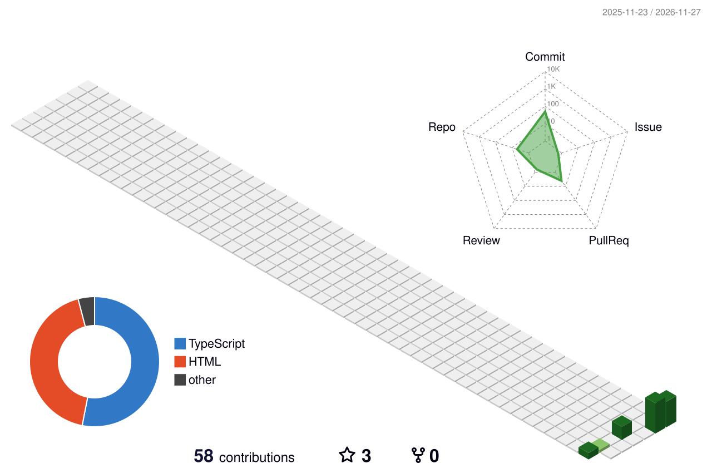

<!--
  Profile README: UTTARAVALLIROHITH
  Animated space theme with automatic GitHub light/dark variants.
  Generated assets are maintained by GitHub Actions.
-->

# Uttaravalli Rohith — GitHub Profile

**Uttaravalli Rohith** is a Diploma Computer Engineering (CME) student from Andhra Pradesh, India, building software development and cybersecurity projects. Explore my GitHub repositories, web development projects, API security experiments, and computer engineering learning journey.

 

---

## 🌌 About Me

Hey! I'm **Uttaravalli Rohith**, a Diploma student in **Computer Engineering (CME)** at **Avanthi Institute of Engineering & Technology, Andhra Pradesh, India**. I expect to complete my diploma in **2027**.

I'm interested in understanding how technology works and turning what I learn into practical projects. My current interests include web development, software engineering, computer networks, and cybersecurity.

- 🎓 Diploma in Computer Engineering (CME) — expected 2027
- 💻 Learning JavaScript, React, TypeScript, and modern web development
- 🔐 Exploring cybersecurity fundamentals, ethical hacking concepts, and API security
- 🌐 Building knowledge in computer networks, DBMS, operating systems, and data structures
- 🧪 Learning by building, testing, debugging, and improving
- 🤝 Open to student collaboration, learning opportunities, and suitable internships

## 🪐 Featured Projects

<table>
  <tr>
    <td width="50%" valign="top">
      <h3><a href="https://github.com/UTTARAVALLIROHITH/skillproof-3d">SkillProof 3D</a></h3>
      
A 3D portfolio and evidence workspace that helps students present skills through projects, certificates, and practical proof.

      
<strong>Highlights:</strong> Skill Universe · Project Galaxy · Certificate Vault · Evidence Engine · Skill Passport · Import Center

      <a href="https://uttaravallirohith.github.io/skillproof-3d/">🌐 Live website</a>
        
      
      
    </td>
    <td width="50%" valign="top">
      <h3><a href="https://github.com/UTTARAVALLIROHITH/SafeNow">SafeNow</a></h3>
      
A personal-safety project exploring voice-assisted SOS workflows and emergency support for Android.

      
<strong>Focus:</strong> SOS activation · trusted contacts · location-sharing concepts · safety-first design

      <a href="https://uttaravallirohith.github.io/SafeNow/">🌐 Project website</a>
        
      
    </td>
  </tr>
  <tr>
    <td width="50%" valign="top">
      <h3><a href="https://github.com/UTTARAVALLIROHITH/API-Sentinel-AI">API Sentinel AI</a></h3>
      
An early-stage API security analyzer project focused on endpoint inspection, security checks, evidence-backed findings, and helpful remediation guidance.

      
<strong>Status:</strong> Early development; planned capabilities are not presented as completed features.

      
    </td>
    <td width="50%" valign="top">
      <h3><a href="https://github.com/UTTARAVALLIROHITH/love-in-every-language">Love in Every Language</a></h3>
      
A creative multilingual web experience that forms a typographic heart, with animated 2D/3D visuals and personalisation.

      
<strong>Highlights:</strong> Interactive 3D heart · multilingual expressions · design studio · shareable creations

      <a href="https://uttaravallirohith.github.io/love-in-every-language/">🌐 Try the experience</a>
        
      
      
    </td>
  </tr>
</table>

### More repositories

- [NsRedEye](https://github.com/UTTARAVALLIROHITH/NsRedEye)
- [HyperClip](https://github.com/UTTARAVALLIROHITH/HyperClip)
- [Bharath](https://github.com/UTTARAVALLIROHITH/Bharath)

## 🧰 Technologies & Learning

**Current learning areas:** programming fundamentals · frontend development · REST APIs · SQL and DBMS · computer networks · operating systems · cybersecurity basics · API security.

> These icons represent technologies I am learning or exploring; they are not a claim of professional mastery.

## 📊 GitHub Overview

  <picture>
    <source media="(prefers-color-scheme: dark)" srcset="https://github-readme-stats.vercel.app/api?username=UTTARAVALLIROHITH&show_icons=true&include_all_commits=true&hide_border=true&theme=github_dark&rank_icon=github" />
    <source media="(prefers-color-scheme: light)" srcset="https://github-readme-stats.vercel.app/api?username=UTTARAVALLIROHITH&show_icons=true&include_all_commits=true&hide_border=true&theme=default&rank_icon=github" />
    
  </picture>
  <picture>
    <source media="(prefers-color-scheme: dark)" srcset="https://github-readme-stats.vercel.app/api/top-langs/?username=UTTARAVALLIROHITH&layout=compact&hide_border=true&theme=github_dark&langs_count=8" />
    <source media="(prefers-color-scheme: light)" srcset="https://github-readme-stats.vercel.app/api/top-langs/?username=UTTARAVALLIROHITH&layout=compact&hide_border=true&theme=default&langs_count=8" />
    
  </picture>

  

## 🐍 Contribution Journey

This snake animation is generated from my real GitHub contribution calendar by GitHub Actions.

  <picture>
    <source media="(prefers-color-scheme: dark)" srcset="https://raw.githubusercontent.com/UTTARAVALLIROHITH/UTTARAVALLIROHITH/output/github-contribution-grid-snake-dark.svg" />
    <source media="(prefers-color-scheme: light)" srcset="https://raw.githubusercontent.com/UTTARAVALLIROHITH/UTTARAVALLIROHITH/output/github-contribution-grid-snake.svg" />
    
  </picture>

## 🧊 3D Contribution Calendar

Automatically generated 3D contribution views. The images appear after the 3D workflow completes successfully for the first time.

  <picture>
    <source media="(prefers-color-scheme: dark)" srcset="./profile-3d-contrib/profile-night-view.svg" />
    <source media="(prefers-color-scheme: light)" srcset="./profile-3d-contrib/profile-green-animate.svg" />
    
  </picture>

## 📈 Activity

  

## 🤝 Connect With Me

 

**Thanks for visiting my profile!**  
*Keep exploring. Keep building. Keep learning.* 🚀

